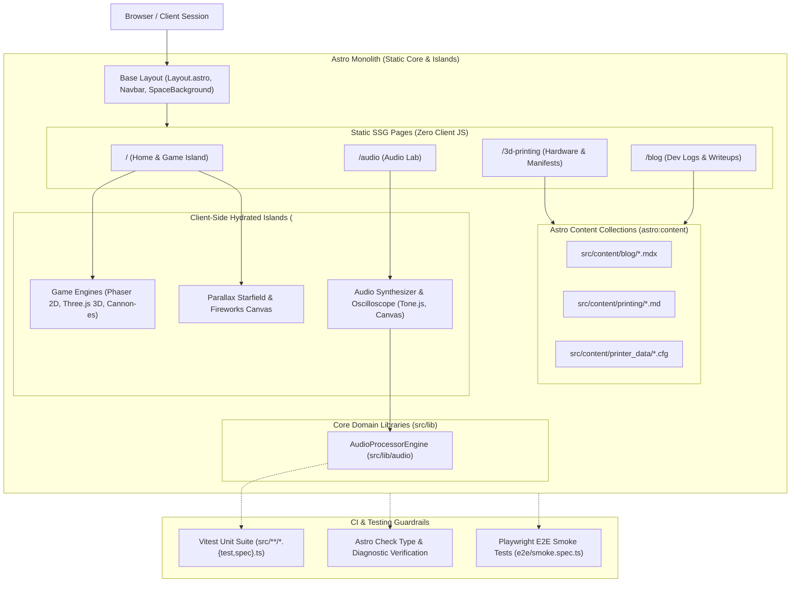

# 🌐 Goobface :: Personal Creative Monolith

**Goobface** is a unified digital playground, creative laboratory, and documentation hub. It consolidates game development, WebAudio synthesis, 3D printing hardware logs, Klipper configurations, and technical logs into a single **Astro-powered monolithic web application**.

**Deployed independently at [goobface.com](https://goobface.com)**.

---

## ⚡ Project Overview

Previously structured as a federated hub-and-spoke setup across separate repositories, `goobface` has been consolidated into a **Unified Astro Monolith**. This single repository hosts all interactive web applications, audio tools, 3D printing specs, and game engines under one unified dev environment (`npm run dev`) and deployment bundle.

### Integrated Applications & Modules

| Module | Route | Technologies | Purpose |
| :--- | :--- | :--- | :--- |
| **🕹️ Desktop OS & Game Island** | `/` | Astro, Phaser.js, Three.js, Cannon-es | Simulated OS desktop UI managing 2D/3D arcade games (`Pong`, `BlockBreaker`, `Racing3D`). |
| **🎛️ Creative Audio Lab** | `/audio` | Tone.js, HTML5 Canvas, Web Audio API | Interactive synthesizer, DSP effect chains (distortion, delay), and real-time canvas oscilloscope spectrum visualizers. |
| **🖨️ 3D Printing Lab & Config Store** | `/3d-printing`, `/3d-printing/configs` | Astro MDX, Content Collections, Klipper INI | Hardware manifests, Ender-3 Pro upgrade logs, and interactive Klipper config code viewer (`printer.cfg`, `mainsail.conf`, `moonraker.conf`, etc.). |
| **🌌 Space Theme Canvas Engine** | `/` | HTML5 Canvas | Background parallax starfield and interactive particle fireworks engine. |

---

## 🛠️ Technology Stack & Selection Rationale

This project balances extreme performance with rich interactivity through a hybrid architecture:

| Technology | Category | Role & Selection Rationale |
| :--- | :--- | :--- |
| **Astro** | Core Framework | Chosen for its **Islands Architecture**, keeping 90% of the site static HTML (ultra-fast, zero JS overhead) while selectively hydrating heavy canvas/sound islands only when active. Runs on **Vite** under the hood for HMR and module bundling. |
| **TypeScript** | Language | End-to-end type safety across components, audio engines, content collections, and game modules. |
| **Tone.js** | Web Audio | Powers the **Creative Audio Lab**. Provides a high-level Web Audio framework for synthesis (`MonoSynth`), DSP effect chains (`Distortion`, `FeedbackDelay`), and transport scheduling. |
| **Three.js & Cannon-es** | 3D & Physics | Powers 3D arcade games (`Racing3D`) and WebGL graphics. Cannon-es provides realistic rigid-body physics and `RaycastVehicle` suspension simulation. |
| **Phaser.js** | 2D Arcade Engine | Chosen for 2D arcade games (`Pong`, `BlockBreaker`) due to its optimized canvas rendering and 60fps performance on low-power devices. |
| **TailwindCSS** | Styling | Modern atomic utility styling tailored for dark mode aesthetics, glassmorphism, and responsive UI layouts. |
| **Docker & Compose** | Containerization | Multi-mode execution: Standalone mode for isolated dev (port 4321) and Private Cloud Cluster mode for reverse-proxy gateway routing. |

---

## 🧠 Architectural Mental Model

The following diagram illustrates how the unified Astro monolith orchestrates static content, interactive client islands, domain engines, and the testing guardrails:



---

## 🏗️ Project Structure

The codebase uses a **Unified Astro Monolith** directory layout:

```text
goobface/
├── .github/              # GitHub Actions workflows & PR templates
│   └── workflows/        # CI automation (agent-gatekeeper.yml)
├── e2e/                  # End-to-end headless browser smoke tests (Playwright)
├── public/               # Public static assets & favicon
├── scripts/              # Build, validation & generator scripts
│   ├── generate-arch-map.mjs # Generates architecture map (.agents/architecture-map.json)
│   └── verify-docs.mjs       # Validates doc path references exist on disk
├── src/
│   ├── apps/             # Integrated feature application containers
│   │   ├── 3d-lab/       # 3D Printing Lab & Hardware Docs container
│   │   └── audio-lab/    # Creative Audio Lab app container
│   ├── components/       # UI component hierarchy & client islands
│   │   ├── audio/        # AudioProcessor.astro component
│   │   ├── games/        # Game islands (Pong.astro, BlockBreaker.astro, Racing3D.astro, GameIsland.astro)
│   │   └── ui/           # Shared UI (Navbar.astro, SpaceBackground.astro)
│   ├── content/          # Type-safe content collections & data
│   │   ├── blog/         # General dev logs (MDX)
│   │   ├── printer_data/ # Klipper config files (.cfg, .conf)
│   │   └── printing/     # 3D printing posts (MD)
│   ├── layouts/          # Base HTML layouts (Layout.astro, BlogPost.astro)
│   ├── lib/              # Core domain engines & utility libraries
│   │   └── audio/        # Tone.js AudioProcessorEngine (processor.ts) & Vitest unit tests
│   ├── pages/            # Astro route entry points
│   │   ├── 3d-printing/  # 3D Printing Lab & Klipper config viewer (/3d-printing)
│   │   ├── audio/        # Creative Audio Lab (/audio)
│   │   ├── blog/         # Technical blog logs (/blog)
│   │   └── index.astro   # Desktop OS & Game Island (/)
│   ├── styles/           # Global CSS & Tailwind design tokens
│   └── content.config.ts # Content collection schema definitions
├── Dockerfile            # Multi-stage container definition
├── docker-compose.yml    # Development container orchestration
├── playwright.config.ts  # Playwright configuration
├── tsconfig.json         # Strict TypeScript configuration
└── vitest.config.ts      # Vitest unit test configuration
```

---

## 🚀 Quick Start & Development

### Local Development
```bash
# Install dependencies
npm install

# Start unified Astro dev server (port 4321)
npm run dev

# Check TypeScript & Astro diagnostics
npm run astro check

# Run unit test suite (Vitest)
npm run test:ci

# Run end-to-end smoke tests (Playwright)
npx playwright test

# Build production static bundle
npm run build
```

### 🐳 Docker Execution

```bash
# Build and run local development container (port 4321)
docker compose up
```

---

## 🤖 AI Agent Protocol

- **`AGENTS.md`**: Architectural rules, execution modes, and handoff protocols for AI assistants.

---

## 🤝 Contributing

We follow a unified monorepo workflow across all integrated apps and content.

1. **Branching**: Use `feature/` for new tools/games/content and `infra/` for build scripts/configs.
2. **Pull Requests**: Never commit directly to `main`. Always submit a PR from your branch for review.
3. **SSR Safety**: Scoped client-side scripts using `<script>` or `client:only` for canvas/sound dependencies (Phaser, Three.js, Tone.js).
